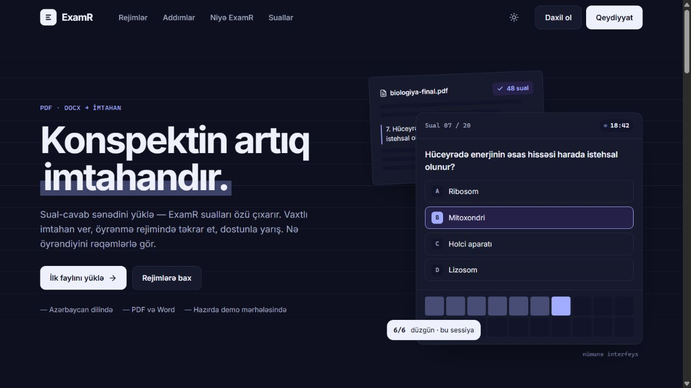
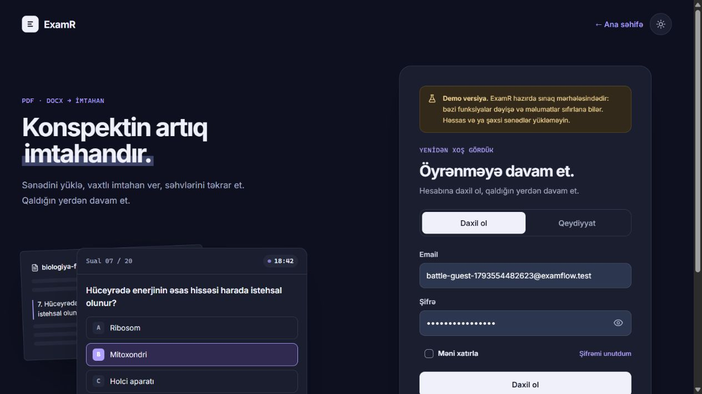
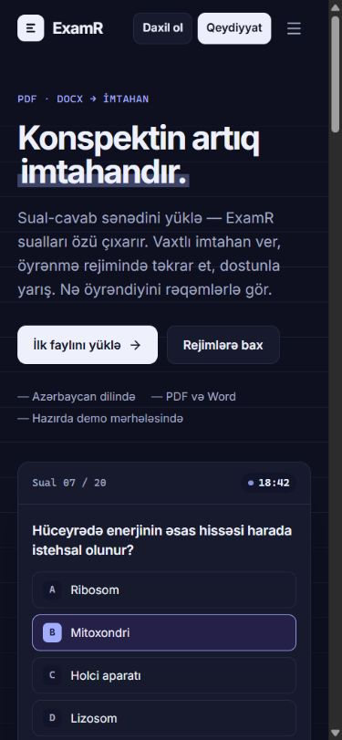
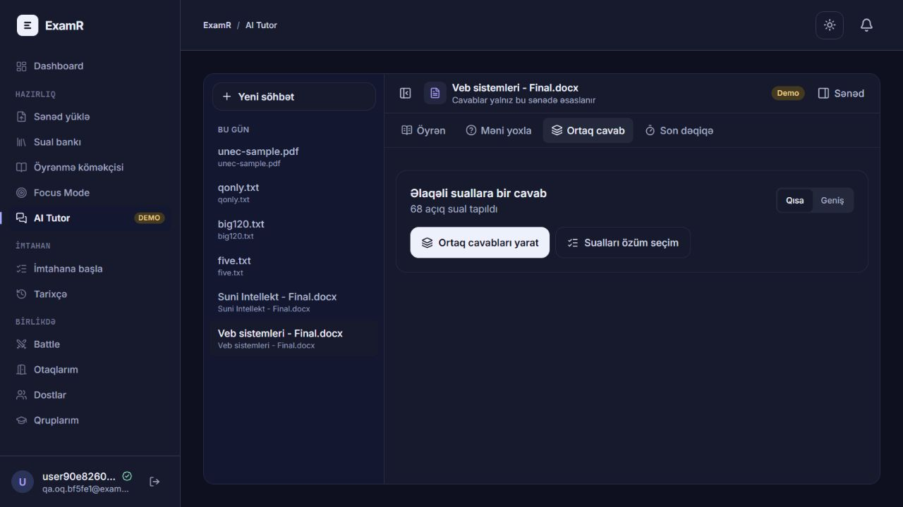
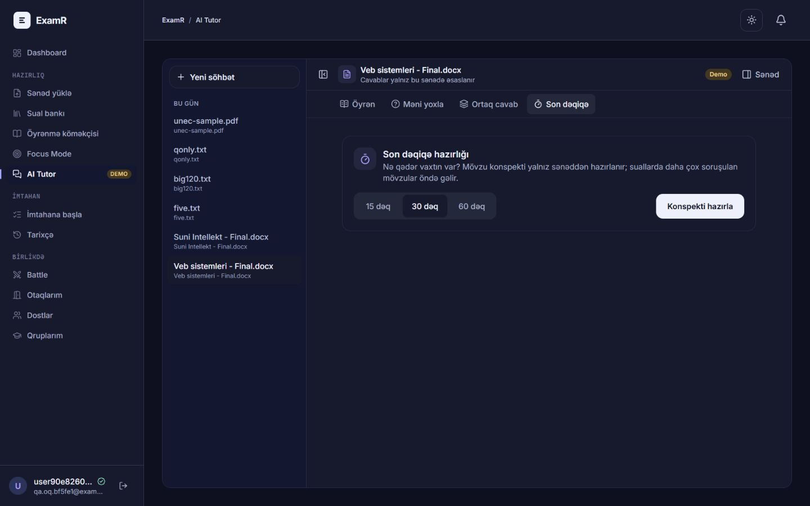

# ExamR

**PDF və Word sənədlərini imtahana, fərdi məşqə və dostlarla canlı yarışa çevirən Azərbaycan dilli platforma.**

ExamR sənəddən sualları çıxarır, şəxsi kitabxanada saxlayır və hazırlığı bir yerdən idarə etməyə imkan verir: vaxtlı imtahan, cavabların təhlili, sənədə əsaslanan AI Tutor, Battle və fokus sessiyaları.



## İmkanlar

| Modul | İstifadəçi nə edə bilir? |
|---|---|
| Sənəd kitabxanası | PDF/DOCX yükləmək, emal vəziyyətini və hesabatını görmək, şəxsi sənədləri idarə etmək |
| Sual bankı | Çıxarılmış suallara baxmaq, axtarmaq, cavabları yoxlamaq və mövcud redaktə alətlərindən istifadə etmək |
| Sınaq imtahanı | Sənəd və sual nömrələri aralığı seçmək, təsadüfi sualları taymerlə cavablamaq, nəticəni dərhal və ya sonda görmək |
| Tarixçə | Əvvəlki imtahanları, cavabları və nəticələri yenidən nəzərdən keçirmək |
| Study | Sənəd əsaslı məşqlər, açıq və variantlı cavablar, zəif mövzular və təkrar axını |
| AI Tutor — Öyrən | Sənədlə bağlı sual vermək, axınla cavab almaq və mənbə səhifələrinə baxmaq |
| AI Tutor — Məni yoxla | Açıq suala cavab vermək, düzgün/qismən/səhv qiymət və mənbəyə əsaslanan izah almaq |
| AI Tutor — Ortaq cavab | Açıq sualları mövzu üzrə qruplaşdırmaq, qısa/uzun ortaq cavab və hər suala xüsusi əlavələri görmək; sualları əl ilə seçmək |
| AI Tutor — Son dəqiqə | 15/30/60 dəqiqəlik sənəd konspekti, mövzular və yadda saxlanmalı açar anlayışlar hazırlamaq |
| Battle | SignalR ilə canlı otaq, dost dəvəti, taymer, chat, sürətə əsaslanan xal, sıralama və reytinq |
| Sosial | Nickname, avatar, profil, dostluq, bloklama və real vaxt bildirişləri |
| Qruplar və admin | Qrup üzvləri ilə sənəd paylaşmaq, istifadəçi/rol və sənəd idarəetməsi |
| Fokus | Hazırlıq üçün fokus sessiyaları və vaxt izləmə |
| İnterfeys | Mobil və masaüstü görünüş, açıq/tünd tema, Azərbaycan dilində mətnlər |

### Ekran görüntüləri

Aşağıdakılar lokal tətbiqdən götürülmüş görüntülərdir. Ana səhifənin içindəki sual kartı məhsulun öz nümayiş nümunəsidir.

| Giriş | Mobil ana səhifə |
|---|---|
|  |  |

**AI Tutor — ortaq cavab seçimi**



**AI Tutor — son dəqiqə hazırlığı**



Tutor görüntüləri ayrıca lokal QA hesabından götürülüb; bunlar material yaratmazdan əvvəlki seçim ekranlarıdır.

## İstifadə axını

1. Hesab yaradın və email təsdiqini tamamlayın; konfiqurasiya olunubsa Google ilə də daxil olmaq mümkündür.
2. **Sənəd yüklə** bölməsindən mətn əsaslı PDF və ya DOCX əlavə edin, emalın tamamlanmasını gözləyin.
3. Çıxarılmış sualları və cavabları nəzərdən keçirin. Avtomatik parsing nəticəsi sənədin formatından asılıdır.
4. **İmtahan** üçün sənədi, nömrə aralığını və sual sayını seçin; yaxud **Study / AI Tutor** ilə məşq edin.
5. Dostlarla yarış üçün **Battle** otağı yaradın və dəvət göndərin.
6. Nəticələri tarixçədə izləyin və səhv cavabları təkrar edin.

AI Tutor-da “Ortaq cavab” açıq suallı sənədlər üçündür. Variantlı test aşkar ediləndə bu funksiya uyğun xəbərdarlıq göstərir. Sənəddə cavab olmayan suallar üçün yalnız sənədin başqa hissələrində tapılan məlumat istifadə edilir; dəstəklənməyən cavablar ayrıca göstərilir. Eyni sənəd versiyası və eyni parametrlər üçün hazırlanmış material keşdən qaytarılır.

## Texnologiyalar və quruluş

- **API:** ASP.NET Core 9 Minimal APIs, EF Core 9, SQL Server, Identity və JWT.
- **Real vaxt:** ASP.NET Core SignalR (`/hubs/battle`, `/hubs/social`).
- **Parsing:** PdfPig və əlavə Word paketi tələb etməyən ZIP/XML DOCX oxuyucusu.
- **Frontend:** React 19, TypeScript, Vite, Tailwind CSS v4, TanStack Query və React Router.
- **AI:** backend-dən OpenAI çağırışları, sənəd hissələrinin leksik retrieval-ı, strukturlaşdırılmış JSON nəticələri və SSE chat.
- **Testlər:** xUnit ilə parser və API-nin saf domen məntiqi.

```text
client/                          React SPA
src/ExamFlow.Api/
  Features/                      Auth, Documents, Questions, Exams, Battles,
                                 Friends, Groups, Study, Learning, Focus…
  Infrastructure/                EF Core, migrations, security, email, storage
src/ExamFlow.Parsing/             PDF/DOCX parsing; HTTP və EF-dən asılı deyil
tests/ExamFlow.Api.Tests/         API məntiqi və müqavilə testləri
tests/ExamFlow.Parsing.Tests/     Generasiya edilmiş və lokal nümunə sənədlər
docs/screenshots/                README ekran görüntüləri
```

Brauzer → Vite `/api` və `/hubs` proxy → ASP.NET Core → SQL Server. Ağır sənəd emalı arxa plan növbəsində aparılır. AI açarı brauzerə ötürülmür. Daxili layihə və namespace adları `ExamFlow`, görünən məhsul adı `ExamR`-dir.

## Lokal quraşdırma

### Tələblər

- .NET **9 SDK** və SQL Server instansı.
- Vite 8 ilə uyğun Node.js: **20.19+ və ya 22.12+**.
- npm və Git.
- EF Core CLI **9.x** (`dotnet-ef`).

### 1. Repozitoriyanı götürün

```powershell
git clone https://github.com/alesskeroov/ExamR.git
cd ExamR
npm ci --prefix client
dotnet restore
# Yalnız dotnet-ef quraşdırılmayıbsa:
dotnet tool install --global dotnet-ef --version "9.*"
```

### 2. Gizli konfiqurasiyanı yazın

Aşağıdakı əmrlər repo kökündən icra olunur. Yer tutucuları öz lokal dəyərlərinizlə əvəz edin.

```powershell
dotnet user-secrets set "ConnectionStrings:Default" "Server=.;Database=ExamFlow;Trusted_Connection=True;TrustServerCertificate=True" --project src/ExamFlow.Api
dotnet user-secrets set "Jwt:SigningKey" "<ən azı 32 bayt təsadüfi gizli açar>" --project src/ExamFlow.Api
```

Connection string və signing key olmadan API başlamır. `.env`, şifrələr və API açarları Git-ə daxil edilməməlidir.

### 3. Bazanı yaradın / yeniləyin

```powershell
dotnet ef database update --project src/ExamFlow.Api
```

Bu əmr konfiqurasiya edilmiş bazaya migration tətbiq edir. Lokal instans seçdiyinizi yoxlayın; production migration-larını ayrıca deploy prosesi ilə idarə edin.

### 4. İki terminalda başladın

```powershell
# Terminal 1 — API
dotnet run --project src/ExamFlow.Api
```

```powershell
# Terminal 2 — frontend
cd client
npm run dev
```

- UI: **http://localhost:5190**
- API: **http://localhost:5180**
- Sağlamlıq: **http://localhost:5180/api/health**
- Development OpenAPI: **http://localhost:5180/openapi/v1.json**

Lokal emaillər `src/ExamFlow.Api/App_Data/mail/` altında `.eml` kimi yazılır. Qeydiyyat təsdiqi və şifrə bərpası linkini həmin məktubdan açın. Real email çatdırılması üçün SMTP və ya mövcud Gmail konfiqurasiyasını qurmaq lazımdır.

### 5. AI Tutor-u aktivləşdirin (istəyə bağlı)

```powershell
dotnet user-secrets set "OpenAI:ApiKey" "<OpenAI API açarınız>" --project src/ExamFlow.Api
dotnet user-secrets set "LearningAi:Enabled" "true" --project src/ExamFlow.Api
```

API-ni yenidən başladın. Alternativ açar: `OPENAI_API_KEY` mühit dəyişəni. Standart olaraq Tutor AI söndürülüb. Cari konfiqurasiyada əsas model `gpt-4.1-mini`, yüngül qruplaşdırma modeli `gpt-4o-mini`-dir. Model adları və token/xərc əmsalları `appsettings.json` ilə dəyişdirilir; oradakı əmsallar tətbiqin xərc hesablaması üçündür.

`LearningAi:TotalBudgetUsd` standart **4 USD**, `DailyRequestsPerUser` **40**-dır. Büdcə bütün Tutor istifadəsi üzrə uçota alınır; ayrıca Study modulunun gündəlik limiti və uçotu var. Bir material hazırlamaq bir neçə model çağırışı tələb edə bilər. AI ilə işləyərkən əlaqəli sənəd mətnləri xarici model xidmətinə göndərilir.

İlk admin üçün lokal user-secrets-də `Seed:Admin:Email` və `Seed:Admin:Password` təyin edilə bilər. Şifrəni mənbə fayllarına yazmayın.

## Əsas konfiqurasiya

| Açar / bölmə | Məqsəd |
|---|---|
| `ConnectionStrings:Default` | SQL Server / Azure SQL bağlantısı; secret |
| `Jwt:SigningKey` | JWT imzası; secret, minimum 32 bayt |
| `Jwt:AccessTokenMinutes` | Standart sessiya müddəti, 60 dəqiqə |
| `App:FrontendBaseUrl` | Email linklərinin frontend bazası |
| `App:PublicOrigin` | Reverse proxy arxasında açıq origin və OAuth URL-ləri |
| `Authentication:Google:*` | İstəyə bağlı Google giriş konfiqurasiyası |
| `Documents:*` | Standart upload: 20 MB, 300 səhifə, 60 saniyə parsing limiti |
| `Learning:*` | Tutor sənəd emalı və retrieval limitləri |
| `LearningAi:*` | Tutor aktivliyi, modellər, büdcə, token və vaxt limitləri |
| `StudyAi:*` | Study modulunun ayrıca AI konfiqurasiyası |
| `Smtp:*` | SMTP və ya lokal mail pickup |
| `Storage:RootPath` | Lokal sənəd saxlama qovluğu |
| `DataProtection:KeysPath` | Restart-lar arasında Data Protection açarlarının qalıcı saxlanması |

Production-da nested açarlar iki alt xəttlə yazılır: `ConnectionStrings__Default`, `Jwt__SigningKey`, `LearningAi__Enabled`, `OpenAI__ApiKey`.

## Build və yoxlama

```powershell
dotnet build
dotnet test
npm run build --prefix client
npm run lint --prefix client
```

Build üçün .NET tərəfində 0 xəta və 0 xəbərdarlıq gözlənilir. Frontend build TypeScript yoxlamasını da aparır. Real PDF nümunələri `samples/` altında lokal saxlanır və paylaşılmır; bu fayllar olmadan real nümunə testləri tam format əhatəsi vermir. Bəzi şrift testləri Windows Arial istifadə edir. Unit testlər real SQL Server, brauzer və OpenAI ilə inteqrasiya yoxlamasını əvəz etmir.

## Deploy

Repo kökündəki `Dockerfile` **yalnız API-ni** publish edir; frontend-i özünə daxil etmir.

```powershell
docker build -t examr-api .
```

Frontend üçün `npm ci` və `npm run build` nəticəsi `client/dist/`-dir. SPA hostunda frontend route-larını `index.html`-ə yönləndirin, `/api` və `/hubs` trafikini API-yə ötürün, SignalR üçün WebSocket dəstəyini aktiv saxlayın. `client/public/_headers` hostun dəstəklədiyi təhlükəsizlik başlıqlarını saxlayır. Ayrı origin istifadə edilirsə cookie, CORS və OAuth redirect konfiqurasiyası həmin yerləşdirməyə uyğun olmalıdır.

SQL migration-ları deploy-dan əvvəl idarə olunan mərhələdə tətbiq edilməlidir. Upload-lar və Data Protection açarları üçün qalıcı saxlama qurun; container-in müvəqqəti fayl sisteminə güvənməyin. Repo həm lokal saxlama, həm də mövcud S3 konfiqurasiya yolunu ehtiva edir.

## Təhlükəsizlik və sərhədlər

- İstifadəçi resursları ownership və paylaşım icazəsi ilə yoxlanılır; başqasının şəxsi resursu `404` qaytarır.
- Düzgün imtahan cavabı yalnız seçilmiş reveal qaydası icazə verdikdə göndərilir; qiymətləndirmə serverdədir.
- JWT sessiyası HttpOnly cookie ilə daşınır; aktiv cookie sessiyası müddətin yarısından sonra sürüşən yenilənmə ilə uzadılır. Təhlükəsizlik möhürü dəyişdikdə köhnə tokenlər ləğv edilir. Ayrı refresh token yoxdur.
- PDF parsing mətn əsaslıdır, OCR yoxdur. Cavabın avtomatik aşkarlanması mənbənin formatına bağlıdır.
- AI cavabı mənbəyə bağlansa da, səhv edə bilər; imtahan hazırlığında orijinal sənədlə müqayisə edin.
- Battle otaqları və snapshot-lar bazada qalır, oyun dövrü və online presence bir serverin yaddaşındadır. Çox instans üçün ayrıca koordinasiya lazımdır.
- .NET 10 LTS keçidi ayrıca planlaşdırılmalıdır; cari layihələr `net9.0` hədəfləyir.

## Tez-tez rast gəlinən problemlər

| Problem | Yoxlanacaq yer |
|---|---|
| API başlamır | İki məcburi secret, SQL Server instansı və bağlantı icazəsi |
| Yeni endpoint `404` verir | İşləyən API-nin cari build olduğunu yoxlayın və köhnə prosesi dayandırıb başladın |
| `dotnet build` fayl kilidi verir | İşləyən API-ni dayandırın; `bin/` fayllarını proses kilidləyə bilər |
| Email gəlmir | Development `.eml` qovluğu və SMTP/provider konfiqurasiyası |
| Tutor `503` verir | `LearningAi:Enabled`, OpenAI açarı və API restart |
| Tutor `429` verir | Gündəlik limit, IP rate limit və ya bitməmiş paralel sorğu |
| Sənəddən sual çıxmır | PDF-də seçilə bilən mətn, nömrələmə, variant və cavab formatı |
| Battle canlı yenilənmir | `/hubs` proxy-si və WebSocket dəstəyi |
| Vite 5190 portunda başlamır | Portu tutan əvvəlki frontend prosesini yoxlayın; `strictPort` aktivdir |
