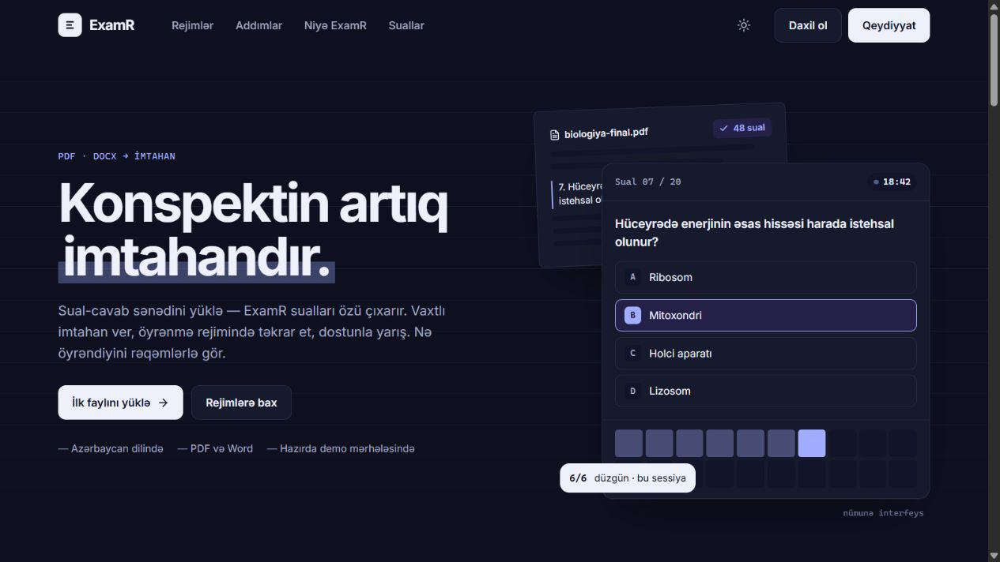
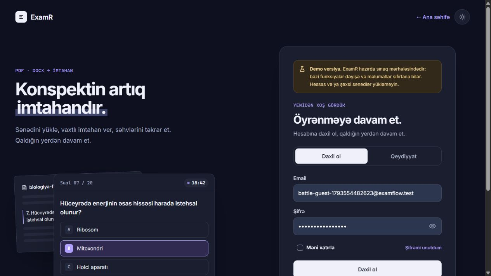
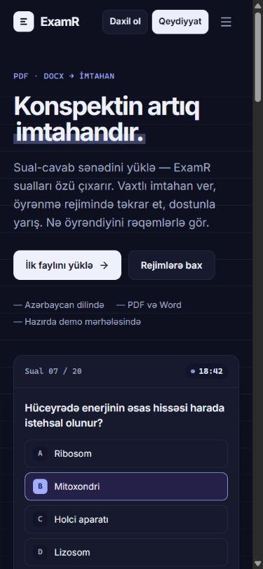
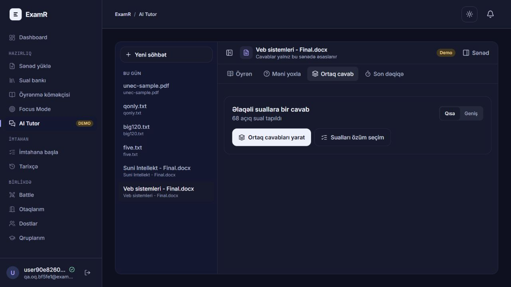
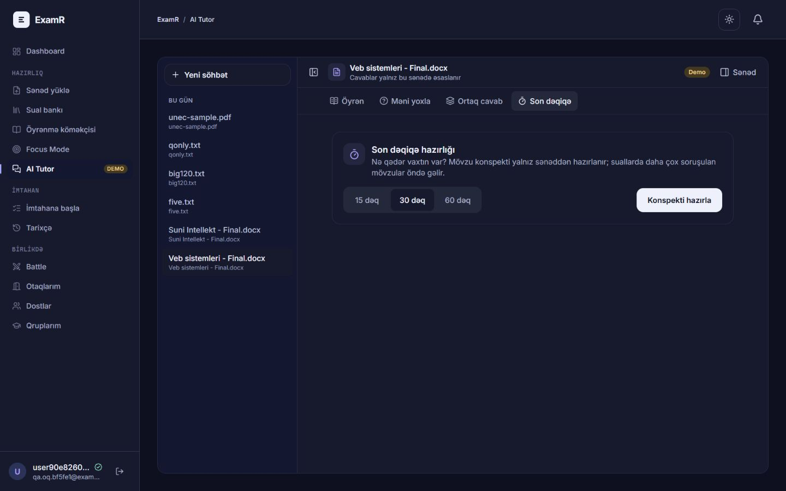
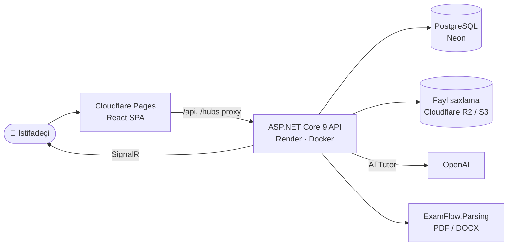
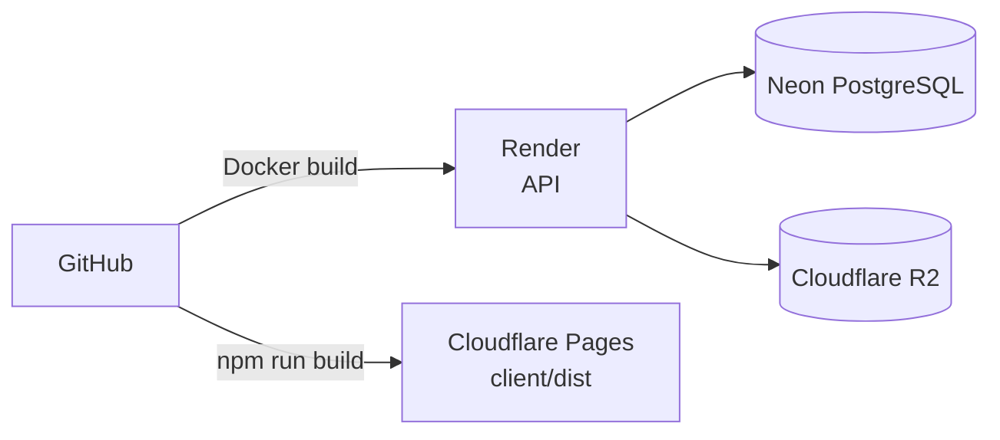

<div align="center">

# ExamR

**PDF, Word və PowerPoint sənədlərini imtahana, fərdi məşqə və dostlarla canlı yarışa çevirən Azərbaycan dilli platforma**


[**🌐 Canlı sayt — examr.pages.dev**](https://examr.pages.dev/)

</div>

---

## 📌 Haqqında

**ExamR** sənəddən sualları avtomatik çıxarır, şəxsi kitabxanada saxlayır və imtahana hazırlığı bir yerdən idarə etməyə imkan verir:
vaxtlı imtahanlar, cavabların təhlili, sənədə əsaslanan **AI Tutor**, DİM formatlı sınaqlar, dostlarla canlı **Battle** və fokus sessiyaları.

<div align="center">
  
</div>

> Daxili layihə və namespace adları `ExamFlow`, istifadəçiyə görünən məhsul adı `ExamR`-dir.

---

## ✨ İmkanlar

| Modul | İstifadəçi nə edə bilir? |
|---|---|
| 📚 **Sənəd kitabxanası** | PDF/DOCX yükləmək, emal vəziyyətini və hesabatını görmək, şəxsi sənədləri idarə etmək |
| ❓ **Sual bankı** | Çıxarılmış suallara baxmaq, axtarmaq, cavabları yoxlamaq və redaktə etmək |
| 📝 **Sınaq imtahanı** | Sənəd və sual aralığı seçmək, təsadüfi sualları taymerlə cavablamaq, nəticəni dərhal və ya sonda görmək |
| 🎓 **DİM sınaqları** | Buraxılış və blok formatında sınaqlar: qapalı (A–E) və açıq kodlaşdırılan suallar, hesabat kartı |
| 🕓 **Tarixçə** | Əvvəlki imtahanları, cavabları və nəticələri yenidən nəzərdən keçirmək |
| 📖 **Study** | Sənəd əsaslı məşqlər, açıq və variantlı cavablar, zəif mövzular və təkrar axını |
| 🤖 **AI Tutor — Öyrən** | Sənədlə bağlı sual vermək, axınla (streaming) cavab almaq, mənbə səhifələrinə baxmaq |
| ✅ **AI Tutor — Məni yoxla** | Açıq suala cavab vermək, düzgün/qismən/səhv qiymət və mənbəyə əsaslanan izah almaq |
| 🧩 **AI Tutor — Ortaq cavab** | Açıq sualları mövzu üzrə qruplaşdırmaq, qısa/uzun ortaq cavab hazırlamaq |
| ⏱️ **AI Tutor — Son dəqiqə** | 15/30/60 dəqiqəlik konspekt, mövzular və açar anlayışlar |
| 🗂️ **Öyrənmə bələdçisi** | PDF, DOCX və PPTX-dən slayd və açar termin kartları, qeydlər, axtarış |
| ⚔️ **Battle** | SignalR ilə canlı otaq, dost dəvəti, taymer, chat, sürətə əsaslanan xal və reytinq |
| 👥 **Sosial** | Nickname, avatar, profil, dostluq, bloklama və real vaxt bildirişləri |
| 🛡️ **Qruplar və admin** | Qrup üzvləri ilə sənəd paylaşmaq, istifadəçi/rol və sənəd idarəetməsi |
| 🎯 **Fokus** | Hazırlıq üçün fokus sessiyaları və vaxt izləmə |
| 🎨 **İnterfeys** | Mobil və masaüstü görünüş, açıq/tünd tema, Azərbaycan dilində mətnlər |

### 🖼️ Ekran görüntüləri

| Giriş | Mobil ana səhifə |
|---|---|
|  |  |

| AI Tutor — ortaq cavab | AI Tutor — son dəqiqə |
|---|---|
|  |  |

---

## 🏗️ Arxitektura



- **Vertical slice** quruluşu: hər funksiya `Features/<Modul>` qovluğunda — endpoint, məntiq və DTO bir yerdə
- Ağır sənəd emalı **arxa plan növbəsində** aparılır
- AI açarı **heç vaxt brauzerə ötürülmür** — bütün model çağırışları backend-dədir
- Parsing ayrıca layihədir və HTTP/EF Core-dan asılı deyil

---

## 🧰 Texnologiyalar

| Sahə | Texnologiya |
|---|---|
| Backend | ASP.NET Core 9 Minimal APIs, EF Core 9, ASP.NET Core Identity, JWT (HttpOnly cookie) |
| Verilənlər bazası | PostgreSQL (Neon) — `Npgsql`, ICU `az-x-icu` collation |
| Real vaxt | ASP.NET Core SignalR (`/hubs/battle`, `/hubs/social`) |
| Parsing | PdfPig, əlavə paket tələb etməyən DOCX (ZIP/XML) oxuyucusu |
| AI | OpenAI, sənəd hissələrinin leksik retrieval-ı, strukturlaşdırılmış JSON, SSE chat |
| Frontend | React 19, TypeScript, Vite, Tailwind CSS v4, TanStack Query, React Router |
| Saxlama | Lokal disk, Cloudflare R2 və ya S3-uyğun xidmət |
| Autentifikasiya | Email/şifrə, istəyə bağlı Google OAuth |
| Testlər | xUnit (parser və API domen məntiqi) |
| Deploy | Docker (Render), Cloudflare Pages + Functions, GitHub Actions |

---

## 📁 Layihə strukturu

```text
ExamR/
├── client/                         React SPA (Vite)
│   ├── src/features/               auth, documents, exams, battle, tutor, dim, friends...
│   └── functions/                  Cloudflare Pages Functions — /api və /hubs proxy
├── src/
│   ├── ExamFlow.Api/
│   │   ├── Features/               Auth, Documents, Questions, Exams, Battles, Dim,
│   │   │                           Friends, Groups, Study, Learning, Focus, Usage...
│   │   └── Infrastructure/         EF Core, migrations, security, email, storage
│   └── ExamFlow.Parsing/           PDF/DOCX parsing (HTTP və EF-dən asılı deyil)
├── tests/
│   ├── ExamFlow.Api.Tests/         API məntiqi və müqavilə testləri
│   └── ExamFlow.Parsing.Tests/     Parser testləri
├── scripts/migrate-to-postgres/    Azure SQL → PostgreSQL köçürmə aləti
├── docs/                           Ekran görüntüləri, DİM və Neon sənədləri
└── Dockerfile                      API image-i (Render)
```

---

## 🚀 Lokal quraşdırma

### Tələblər

- [.NET 9 SDK](https://dotnet.microsoft.com/download/dotnet/9.0) və EF Core CLI 9.x (`dotnet-ef`)
- PostgreSQL 17 (lokal və ya Docker)
- Node.js **20.19+** və ya **22.12+** (Vite 8 üçün), npm

### 1. Repozitoriyanı götür

```powershell
git clone https://github.com/alesskeroov/ExamR.git
cd ExamR
npm ci --prefix client
dotnet restore
```

### 2. Gizli konfiqurasiya (user-secrets)

```powershell
dotnet user-secrets set "ConnectionStrings:Default" "Host=localhost;Port=5432;Database=examflow;Username=postgres;Password=<şifrə>" --project src/ExamFlow.Api
dotnet user-secrets set "Jwt:SigningKey" "<ən azı 32 bayt təsadüfi açar>" --project src/ExamFlow.Api
```

> [!IMPORTANT]
> Connection string və signing key olmadan API başlamır. `.env`, şifrələr və API açarları Git-ə daxil edilməməlidir.

### 3. Bazanı yarat

```powershell
dotnet ef database update --project src/ExamFlow.Api
```

### 4. İşə sal (iki terminal)

```powershell
dotnet run --project src/ExamFlow.Api      # Terminal 1 — API
npm run dev --prefix client                # Terminal 2 — frontend
```

| Xidmət | URL |
|---|---|
| UI | http://localhost:5190 |
| API | http://localhost:5180 |
| Sağlamlıq | http://localhost:5180/api/health |
| OpenAPI (Development) | http://localhost:5180/openapi/v1.json |

Lokal emaillər `src/ExamFlow.Api/App_Data/mail/` qovluğuna `.eml` kimi yazılır — qeydiyyat təsdiqi və şifrə bərpası linklərini oradan aç.

### 5. AI Tutor (istəyə bağlı)

```powershell
dotnet user-secrets set "OpenAI:ApiKey" "<OpenAI API açarı>" --project src/ExamFlow.Api
dotnet user-secrets set "LearningAi:Enabled" "true" --project src/ExamFlow.Api
```

Standart olaraq Tutor söndürülüb. Büdcə (`LearningAi:TotalBudgetUsd`, standart 4 USD) və gündəlik limit (`DailyRequestsPerUser`, standart 40) `appsettings.json`-da tənzimlənir.
AI ilə işləyərkən əlaqəli sənəd mətnləri xarici model xidmətinə göndərilir.

---

## ⚙️ Əsas konfiqurasiya

| Açar / bölmə | Məqsəd |
|---|---|
| `ConnectionStrings:Default` | PostgreSQL bağlantısı (secret) |
| `Jwt:SigningKey` | JWT imzası (secret, minimum 32 bayt) |
| `App:FrontendBaseUrl`, `App:PublicOrigin` | Email linkləri, OAuth redirect və cookie origin-i |
| `Authentication:Google:*` | İstəyə bağlı Google giriş |
| `Documents:*` | Upload limitləri (standart: 20 MB, 300 səhifə, 60 saniyə parsing) |
| `Learning:*`, `LearningAi:*`, `StudyAi:*` | Tutor/Study emalı, modellər, büdcə və limitlər |
| `Storage:*` | Lokal, Cloudflare R2 və ya S3 saxlama |
| `Email:*`, `Smtp:*` | Gmail API, Brevo və ya SMTP |

Production-da iç-içə açarlar `__` ilə yazılır: `ConnectionStrings__Default`, `Jwt__SigningKey`, `OpenAI__ApiKey`.
Bütün production dəyişənlərinin siyahısı: [`.env.example`](.env.example).

---

## 🧪 Build və yoxlama

```powershell
dotnet build
dotnet test
npm run build --prefix client
npm run lint --prefix client
```

---

## ☁️ Deploy



- **Backend:** kökdəki `Dockerfile` yalnız API-ni publish edir; Render `PORT` dəyişənini ötürür
- **Frontend:** Cloudflare Pages — build `npm run build`, nəticə `client/dist`; Pages Functions `/api` və `/hubs` trafikini API-yə ötürür (WebSocket daxil)
- **Keep-alive:** GitHub Actions workflow-u pulsuz Render hostunu oyaq saxlayır
- Migration-lar deploy-dan əvvəl ayrıca mərhələdə tətbiq olunur; upload-lar və Data Protection açarları üçün qalıcı saxlama istifadə olunur

---

## 🔒 Təhlükəsizlik və məhdudiyyətlər

- İstifadəçi resursları sahiblik və paylaşım icazəsi ilə yoxlanılır; başqasının şəxsi resursu `404` qaytarır
- Düzgün cavab yalnız seçilmiş reveal qaydası icazə verdikdə göndərilir; qiymətləndirmə serverdə aparılır
- JWT HttpOnly cookie ilə daşınır və sürüşən yenilənmə ilə uzadılır; təhlükəsizlik möhürü dəyişəndə köhnə tokenlər ləğv olunur
- PDF parsing mətn əsaslıdır — **OCR yoxdur**; cavabların avtomatik aşkarlanması sənədin formatından asılıdır
- AI cavabları mənbəyə bağlansa da səhv edə bilər — orijinal sənədlə müqayisə edin
- Battle oyun dövrü və online vəziyyət bir serverin yaddaşındadır; çox instans üçün ayrıca koordinasiya lazımdır

---

## 🛠️ Tez-tez rast gəlinən problemlər

| Problem | Yoxlanacaq yer |
|---|---|
| API başlamır | İki məcburi secret və PostgreSQL bağlantısı |
| `dotnet build` fayl kilidi verir | İşləyən API prosesini dayandır |
| Email gəlmir | Development `.eml` qovluğu və email provider konfiqurasiyası |
| Tutor `503` verir | `LearningAi:Enabled`, OpenAI açarı, API restart |
| Tutor `429` verir | Gündəlik limit, IP rate limit və ya bitməmiş paralel sorğu |
| Sənəddən sual çıxmır | PDF-də seçilə bilən mətn, nömrələmə və variant formatı |
| Battle canlı yenilənmir | `/hubs` proxy-si və WebSocket dəstəyi |
| Vite 5190 portunda başlamır | Portu tutan köhnə frontend prosesi (`strictPort` aktivdir) |

---

## 📄 Əlavə sənədlər

- [DİM sınaqlarının strukturu və qiymətləndirmə](docs/DIM_EXAMS.md)
- [Azure SQL → Neon PostgreSQL köçürməsi](docs/NEON_MIGRATION.md)
